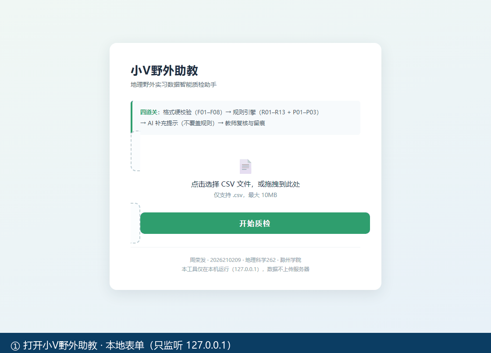

# 小V · 野外助教

**面向地理野外实习的多模型协同质检智能体** —— 让学生在现场用纸质表记录后，在数据变成报告之前，把错误拦下来。




---

## 为什么做这个

地理野外实习有个物理约束：**采样现场没有电脑**。

学生用纸质表记录样方数据，回宿舍再录入 Excel。错误——总盖度超过 100%、经纬度写反、样方编号重复、物种名写错——往往到写报告时才被发现。**那时人已经回不到现场了。**

这不是效率问题，是**数据不可挽回**的问题。

---

## 它怎么工作

四道关，冲突时谁说了算写死在代码里：

| 关卡 | 做什么 | 能否被推翻 |
|---|---|---|
| **① 硬校验** | 字段缺失 / 格式非法 / 类型错误 | ❌ 不可。模型和人工授权都不能放过 |
| **② 规则引擎** | 13 条领域规则 + 3 条照片规则，三级严重度 | ✅ 可授权豁免（需理由 + 范围 + 留痕） |
| **③ 评审模型** | 在规则盲区补充语义类提示 | — 只能新增「提示」级，不能降级规则结论 |
| **④ 裁判模型** | 裁决结论、抑制与规则重复项 | — 拿不准就进人工复核队列 |

### 一个关键设计：规则引擎必须留豁免出口

一条规则拦下的是「**疑似**错误」，不是「**确定**错误」。

野外记录里有大量合法例外——**枝叶重叠时，各物种分盖度之和可以超过 100%，只要总盖度不超**。如果规则引擎没有豁免出口，它会理直气壮地拦下正确数据。这是用户最恨的那种系统。

所以本项目的设计是：

- **硬校验那一层不可豁免**（字段缺失、格式非法——不存在合法的例外）
- **规则引擎这一层可豁免**（填理由 → 限定范围 → 留痕 → **豁免记录回流成规则修订依据**）

### AI 的边界（写进配置，不靠自觉）

```json
"ai_policy": {
  "ai_can_override_rule": false,
  "ai_max_severity": "提示",
  "low_confidence_threshold": 0.6,
  "suppress_duplicate_with_rule": true
}
```

**模型永远不能修改、降级或覆盖规则结论**，只能补充「提示」级内容。这是靠配置强制，不是靠提示词约束。

---

## 13 条规则

| 编号 | 名称 | 级别 |
|---|---|---|
| R01 | 盖度越界（超出 0–100%） | 错误 |
| R02 | 经纬度疑似写反 | 错误 |
| R03 | 调查日期在未来 | 错误 |
| R04 | 调查日期过早（早于 2020） | 错误 |
| R05 | 样方编号重复 | 错误 |
| R06 | 记录 ID 重复 | 错误 |
| R07 | 海拔越界 | 错误 |
| R08 | 盖度与植被类型矛盾 | 错误 |
| R09 | 经纬度与行政区划不匹配 | 警告 |
| R10 | 海拔与经纬度矛盾 | 警告 |
| R11 | 坡向不在受控词表 | 警告 |
| R12 | 物种名疑似别名 | 提示 |
| R13 | 物种名不在名录 | 提示 |

另有 3 条照片规则处理视觉录入的图片检查。

**三级严重度对应工厂质检三档**：错误 → 拒收；授权豁免 → 让步接收；警告/提示 → 留痕。

---

## Quickstart

```bash
git clone <仓库地址>
cd 02_CODE_源代码
pip install -r requirements.txt
cp ../03_CONFIG_配置规则/config.example.json ../03_CONFIG_配置规则/config.json
# 编辑 config.json：填入你的模型 endpoint 与模型名
export DASHSCOPE_API_KEY=<你的 key>     # Windows: set DASHSCOPE_API_KEY=...
python app.py
```

浏览器打开 **http://127.0.0.1:5000**

> 服务只绑定 `127.0.0.1`，不监听局域网。仅接受 `.csv`，大小 ≤10MB，文件名做了安全化处理，不执行上传文件。

### 无 API key 也能跑

模型层是**可降级**的。没有 key 时：
- 硬校验 + 规则引擎**照常运行**
- 模型层自动降级为离线兜底
- 页面「AI 状态」如实显示 `no_api_key_offline_fallback`，**不会假装跑过**

---

## 验证它能跑

```bash
cd 02_CODE_源代码
python -m unittest discover -s tests -v     # 32 项单元测试
python run_eval.py                          # 评测：输出到 output/
```

**实际运行结果（2026-11-19）**：

```
Ran 32 tests in 0.072s
OK
```

完整输出存于 [`docs/测试输出.txt`](docs/测试输出.txt)，评测输出存于 [`docs/评测输出.txt`](docs/评测输出.txt)。

---

## ⚠️ 关于那个 100%

`run_eval.py` 跑自造的 80 行样本，得到召回/精确/F1 都是 100%。

**这个数字不能当作系统能力的证据。** 因为：
- 样本是**按规则人为构造**的，不是真实采集数据
- 用自己按规则造的样本测自己按规则写的引擎，**必然接近 100%**
- 本次运行 `ai_status = no_api_key_offline_fallback`，**模型层没参与**

详见 [`docs/评测说明.md`](docs/评测说明.md)。**「准确率多少」这个问题，目前没有可信答案。**

---

## 当前状态（重要）

**这是单机演示版，不是生产系统。**

### ✅ 已实现并通过验收
- 硬校验 / 规则引擎 13 条 / 三级严重度 / 授权豁免
- JSON Schema 校验与解析失败降级
- 回归校验（学生改完重提，按原任务 ID 比对，分「已修复 / 遗留 / 新增」）
- 离线模式（规则引擎纯本地）
- **32 项单元测试通过**（真实运行，见 docs/）

### ⚠️ 未实现或未测试
- **图像脱敏**：视觉录入会让照片送模型，照片可能含人脸、单据编号、位置信息。目前**只做了文本字段裁剪，图像脱敏没有实现**
- **检出率与误报率未测**：没有可信的准确率数据（见上）
- **教师端**：本版不实现，学生端生成反馈单 PDF 后自行提交
- **手机远程访问**：本期是单机回环演示，手机端以预录屏展示

### ❌ 不包含
- 模型训练（阈值来自专业经验归纳，**不包装成机器学习**）
- 自动提交 / 绕过登录 / 抓取他人数据

---

## 代码结构

| 路径 | 内容 |
|---|---|
| `02_CODE_源代码/app.py` | Flask 表单与结果页，安全边界（只监听本地、限制类型与大小） |
| `02_CODE_源代码/hard_check.py` | 第①关：格式与类型硬校验 |
| `02_CODE_源代码/rule_engine.py` | 第②关：13 条规则 + 三级严重度 + 受控词表 |
| `02_CODE_源代码/model_chain.py` | 第③④关：模型调用、结果过滤、降级与元信息 |
| `02_CODE_源代码/vision_import.py` | 视觉录入层：照片 → 字段 + 置信度，低置信转人工 |
| `02_CODE_源代码/run_eval.py` | 评测脚本：输出 metrics 与问题清单 |
| `03_CONFIG_配置规则/` | `config.json`（主配置）、`rule_config.json`（规则字典）、受控词表 |
| `04_DATA_样本与金标准/` | 样本数据与金标准 |
| `02_CODE_源代码/tests/` | 32 项单元测试 |
| `docs/` | 演示 GIF、测试输出、评测输出与说明 |

**模型可插拔**：模型名只出现在 `03_CONFIG_配置规则/config.json` 的角色映射里（`reviewer` / `judge`），业务代码只认角色。换模型 = 改配置 + 跑回归，不改代码。

---

## 下一步计划

| 项目 | 说明 |
|---|---|
| **检出率 / 误报率对照实验** | 40 份含错样本（5 类 × 8 份）+ 30 份干净表（含「合法但看起来像错误」的边界样本），跑「纯规则 / 规则+模型 / 单模型」三组对照，报检出率、误报率、单份耗时、每百份成本；由教师与同学各独立盲标 |
| 图像脱敏 | 送模型前的图片裁剪与去标识 |
| 本地部署开源权重模型 | 消费级单卡跑 7B–14B 量化版，让数据真正不出域 |

---

## 关于「诚实边界」

这个项目对自己的能力边界写得比功能还详细。不是姿态——在数据质检这个场景，**一个不说明边界的系统比没有系统更危险**：用户会以为它检查过的就是对的。

所以：
- 32 项测试通过，我说「32 项」，并附上原始输出
- 那个 100% 是自测数据集的结果，我就单开一节说明它不算数
- 视觉层没做盲测，我写「未知」，不写「效果良好」
- 没训过 ML，我写「规则来自经验归纳」，不写「机器学习模型」

---

## License

MIT
